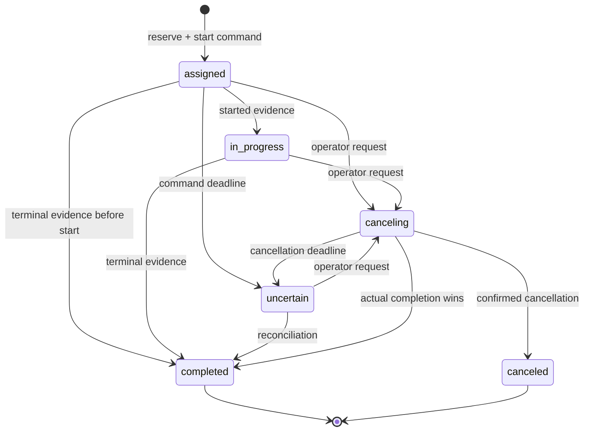

# Architecture and behavioral contracts

Mission-duration prediction is an advisory subsystem with no authority over dispatch, reservations, or terminal state. Its offline training, persisted prediction contract, fallback behavior and monitoring are specified in [ETA design](eta.md).

## Admission and message identity

A gateway key is scoped to one site. Register each vehicle boot before sending messages. Registration is idempotent for `(vehicle_id, boot_id)` and allocates a strictly increasing server generation only for a new boot. Registering an old boot never reactivates it. A stolen site gateway key can impersonate vehicles at that site: individual device authentication is an integration requirement, not a property of this simulator gateway.

Telemetry admission validates the whole batch and commits it atomically before HTTP 202. Every identity `(vehicle_id, boot_id, seq)` binds a canonical payload hash, including the original device timestamp. Changed retries fail the whole batch with 409. Unchanged retries retain the first receipt timestamp and do not repeat business transitions. Contact time is deliberately refreshed by valid current-boot retries to reflect the live gateway link.

New identities must fall within 24 hours of the trusted receipt clock and at most 60 seconds ahead. Existing unchanged identities can be retried after that admission window. Raw identity records are retained indefinitely in this bounded release. Capacity is based on unprocessed inbox rows, not total retained history; 503 responses include `Retry-After`.

## Worker ownership and state authority

A worker acquires the vehicle row with `FOR UPDATE SKIP LOCKED`, then processes a bounded inbox batch in one transaction. Raw outcome markers, snapshots, condition state, incidents, mission outcomes, and audit writes commit together. An interrupted connection rolls back the transaction and releases the row. There is no external-effect lease to fence: a worker makes only database changes within its transaction. Multiple workers can process different vehicles.

Lock order is vehicle, followed by that vehicle's workflow rows. Edge admission sorts all vehicle locks. Idempotency keys are claimed before mutable dispatch eligibility checks. Workers and HTTP workflow mutations serialize through the same vehicle lock. SQL uniqueness constraints backstop duplicate active incidents and duplicate active/uncertain reservations.

Current snapshot order is `(server boot generation, snapshot seq)`. A command report does not advance the snapshot sequence. Event time is preserved for observation freshness; it never overrides session authority. A late old-generation message is retained as historical and cannot mutate active state or mission execution.

## Freshness and incidents

The UI separates gateway contact, device observation, immutable first snapshot receipt, and worker application times. Dispatch requires both recent observation time and recent first receipt; a duplicated gateway receipt or delayed application cannot refresh the age of the applied observation. Boot activation clears the snapshot receipt until new state applies. Device clock skew can make an observation untrustworthy even while contact is healthy. Offline means no current-boot gateway contact for 15 seconds, evaluated once per second. Every online/offline transition increments a vehicle revision.

Battery-low and stuck rules use processing time over observations no more than 10 seconds old, no more than five seconds ahead, and queued no more than 10 seconds. A gap exceeding four seconds resets a pending condition duration. Replay is historical investigation data, not a replay of live alarm decisions. This policy intentionally does not promise identical incident histories under arbitrary delivery schedules.

Battery-low fires below 20% for 10 seconds and clears at 25%. Stuck requires an active mission, status moving, and displacement below 2 m for 20 seconds. Crossing the displacement threshold resets its anchor.

An incident remains open or acknowledged after recovery, with `condition_active=false`, until an operator resolves it with a note. A new fire before resolution reactivates that incident. All automatic and operator mutations increment its version and append timeline evidence. A stale expected version returns 409. An active condition cannot be manually resolved. No reopen window or MTTA/MTTR claims are made in this release.

## Mission attempts and uncertainty

Each mission has an immutable attempt identity. Commands and reports bind command, attempt, and reporting vehicle; a different vehicle cannot acknowledge or complete the attempt. Terminal reports can advance an assigned/unknown attempt without requiring an earlier start report. Delayed start reports cannot regress a terminal mission. An obsolete attempt cannot change a later mission.

A receipt is not execution evidence. A rejection of a command is also not proof that its underlying attempt stopped: rejected start or cancellation commands retain the reservation in uncertainty. Every cancellation retry creates a new immutable command identity and supersedes earlier deliveries. Start-command expiry produces uncertainty while retaining the vehicle reservation. A start report confirms execution; a started mission is not treated as unstarted merely because the original start command TTL passes. Cancellation supersedes redelivery of the start and creates an attempt-scoped cancellation request. Cancellation deadline expiry also retains the reservation. Terminal outcome is required for release; there is no force-reassign escape hatch.

The simulator executes a command through a persisted ledger and persists its report outbox before network transmission. Its durable JSON state models synthetic execution atomically; it does not prove exactly-once physical work. Expired commands are not newly executed. A cancel received before its start fences that attempt against a late start. Only one simulator process may own its local state file.

## Client convergence

Each API instance listens to PostgreSQL commit notifications. A bounded notification coalescer emits only `invalidate` hints, never unbounded entity queues. The socket sends ready after authenticated subscription setup; the browser then reads authoritative state, and polls every five seconds as a fallback. Full-state replacement removes resolved entities from filtered lists naturally. Authoritative state is read using one read-only repeatable-read transaction. Failed synchronization is visible; no convergence guarantee applies while the API is unavailable or a tab is suspended.

The state endpoint is deliberately bounded to 500 vehicles, all active incidents and reserved missions plus the newest 100 resolved incidents and terminal missions, and 40 audit entries. It is a single-site control-room read model, not an unlimited analytics API. Operator views must not be treated as an archive export.

## Security and deployment boundaries

Operator sessions use random opaque cookies; only their SHA-256 hashes are stored. Cookies are HttpOnly and SameSite=Strict, with Secure required for production. Login rotates an existing session. Mutations require same-origin policy and a session CSRF token. Viewer sessions cannot dispatch or mutate incidents; administrators additionally control the demo lab and metrics. Gateway keys use a separate bearer principal and are stored as hashes.

Production startup fails closed if the origin is not HTTPS, cookies are insecure, demo mode is enabled, or the database is unspecified. Schema validation rejects unknown keys and unsafe sequences. Error responses omit database internals and request payloads. Authentication rate limiting is per API process; a multi-instance internet deployment needs an upstream/shared limiter. PostgreSQL storage survival, backup recovery, and device trust are explicitly outside process-crash tests.
